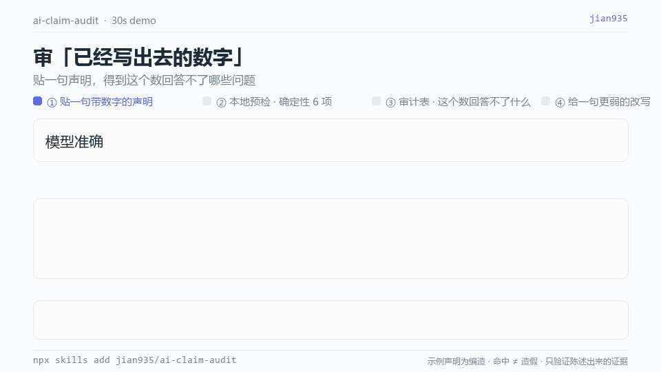

# ai-claim-audit（AI 产品数字体检）

**把任何一句带数字的 AI 产品声明丢进来，得到一张表：这个数字到底回答不了哪些问题。**

[](https://github.com/jian935/ai-claim-audit/actions/workflows/ci.yml)
[English README](README.md) · [MIT](LICENSE) · Python 3.10+ · 零依赖 · 80 条人工标注

> 在 **40 条人工标注声明**上，确定性预检的**声明检出率 80.0%**（95% CI 62.7–90.5）、**micro-F1 0.948**，对 10 条合规声明**误报 0/10**。剩下 20% 是正则看不见的语义问题——这个缺口正是本 skill 存在的理由。完整数字、置信区间和全部保留的错误见 [`evals/RESULTS.md`](evals/RESULTS.md)。
>
> 另有两套评测补上另外两个缺口：**20 条语义裁决案例**（基线 **F1 0.800**）与 **20 条触发精度案例**（基线 **F1 0.842**）。这些是**对照基线，不是模型分数**；真实模型输出用 `--predictions` 打分。见 [`evals/EXTRAS_RESULTS.md`](evals/EXTRAS_RESULTS.md)。

这是一个给 AI 产品经理用的 Agent Skill。它不替你写 PRD，也不替你设计评测方案；它只读你已经写出来的数字，然后问一句：**要想相信它，我还需要看到什么？**

---

## 30 秒上手



<sub>动图里的声明是编造的，页脚已标注；它演示交互，不是实测结果。[静态帧](assets/demo.png) · [生成脚本](scripts/make_demo.py)（Pillow，仅开发用；skill 运行时仍零依赖）。</sub>

```bash
python scripts/audit_claims.py --text "模型准确率达到 94%，下周上线。"
```

```
| # | Claim | Raised | Sev | Question to answer |
| Q01 | 模型准确率达到 94%，下周上线。 | C01, C10 | S2 | 分母是什么？... / 陌生人拿到仓库，能跑出同一个数吗？ |
```

随后由模型裁决脚本打不了分的 6 项语义检查，产出完整报告 [`examples/audit_report.md`](examples/audit_report.md)。注意那份真实生成的报告里：`Q06` 是**自证型目标集**，所有机器能看的证据它都给了，预检因此完全静默；`Q07` 是合规声明，被正确放过。两处都是刻意设计的。

## 安装

```bash
npx skills add jian935/ai-claim-audit
# 或
git clone https://github.com/jian935/ai-claim-audit.git ~/.claude/skills/ai-claim-audit
```

然后把一句话、一段 PRD 或整篇周报贴进对话即可。触发语包括「这个数字能写进周报吗」「帮我看看这份评测报告」「review this launch report」。

## 检查项

| ID | 检查项 | 谁判定 | 严重度 |
|---|---|---|---|
| C01 | 分母与样本量 | 脚本 | S2 |
| C02 | 自证型目标集 | 模型 | **S1** |
| C03 | 标注来源 | 模型 | **S1** |
| C04 | 留出集与泄露 | 模型 | **S1** |
| C05 | 基线／对照组 | 脚本 | S2 |
| C06 | 不确定性（n、区间、重复跑波动） | 脚本 | S2 |
| C07 | 口径唯一源 | 模型 | **S1** |
| C08 | 数据伪影优先于模型质量 | 模型 | **S1** |
| C09 | 编造数据披露 | 脚本 | S3 |
| C10 | 可复现性 | 脚本 | S3 |
| C11 | 单边增益 | 模型 | S2 |
| C12 | 相关写成因果 | 脚本 | S2 |

命中一项 = 提出一个**问题**，不是指控造假。本 skill 不验证数字真伪，只验证「陈述出来的证据是否支撑它」。改写后的声明只会比原文更弱。

## 为什么不是又一个 PM skill 合集

2026-11-05 在 GitHub 上的调研：

| 已经很挤的位置 | 本仓库 |
|---|---|
| PRD／路线图／RICE／JTBD／竞品分析合集，含 70 个 skill 的大合集与 466 个 skill 的跨职业目录 | 不生成任何文档 |
| 覆盖规则→RAG→Agent 选型、证伪式 POC、四层 eval、上线闸门的 AI PM 判断力 skill | 不决定做什么 |
| 至少 4 个 `ai-eval-plan` / `eval-framework-builder` 类 skill | 不设计评测方案 |
| 上述几乎全是纯 Markdown 提示词模板 | 带可运行零依赖脚本、80 条标注、三个跑分器与自动生成的结果表 |

留的缝是有意收窄的：**没人审这些流程最后产出的那串数字。** 一个 skill、一个动作、一句话说得清。

触发精度方向有零星通用检查器（2026-11-05 查到 4 个仓库、最高 2★），但没有本垂直场景的标注集；指标契约／口径漂移工具确实存在（`jigonyoo/metrics-contract`、`vermapragya/open-metric-contracts`），本仓库审的是**声明文本**，不是 dashboard SQL。

## 怎么避免「审别人自证，自己却自证」

一个专门抓自证的 skill，绝不能用自证的方式给自己打分。

1. **目标集按声明类型定义，不按关键词定义。** 标注为 `accuracy_claim`、`lift_claim`、`correlation_claim` 等；一条是不是坏例，取决于人判断这句话有没有给证据，而不是看它有没有命中触发词。
2. **金标是人工判断，不是脚本输出。** 标注与引擎冲突时先判断谁错：`D12` 是标注对、引擎错，所以这个误报被保留。
3. **四条故意让机器看不见的坏例。** `D15`–`D17`、`H11` 是真有问题的声明（循环目标集、用采集搜索词当标注、混口径），但机器金标为**空**。预检对四条全部静默，并计入声明级漏检。
4. **先冻结，再写留出集。** 规则在 `dev.json`（24 条，检出率 77.8%，F1 0.966）上设计完即冻结 `scripts/audit_claims.py`，之后才写措辞不同的 `holdout.json`（16 条）：精确率从 **96.6% 掉到 90.0%**。这个下滑如实报告，没有偷偷修掉。
5. **错误留着不修。** 3 个误报、2 个漏检都保留在 `RESULTS.md`，三类系统性成因写在 [`evals/README.md`](evals/README.md)；10 条合规声明作反向测试（误报 0/10）。
6. **新增两套评测也埋了陷阱。** `S18`、`S19`、`T20` 是故意让浅层基线出错的合规案例；`S11`–`S14`、`T06`、`T09` 是设计成会被漏掉的正例。

诚实说明：两个文件由同一作者编写且都看过，**不是严格意义的独立留出集**，只能算对措辞过拟合的弱防护。

## 评测结果

```bash
python scripts/audit_claims.py --self-test     # 7/7
python scripts/eval_extras.py --self-test      # 10/10
python scripts/run_evals.py --split all --out evals/RESULTS.md
python scripts/eval_extras.py --suite all --out evals/EXTRAS_RESULTS.md
python scripts/check_docs.py
```

| 拆分 | 条数 | 坏例 | 合规 | TP | FP | FN | 精确率 [95% CI] | 召回 [95% CI] | F1 | 声明检出率 [95% CI] | 误报 |
|---|---|---|---|---|---|---|---|---|---|---|---|
| dev | 24 | 18 | 6 | 28 | 1 | 1 | 96.6% [82.8, 99.4] | 96.6% [82.8, 99.4] | 0.966 | 77.8% [54.8, 91.0] | 0/6 |
| holdout | 16 | 12 | 4 | 18 | 2 | 1 | 90.0% [69.9, 97.2] | 94.7% [75.4, 99.1] | 0.923 | 83.3% [55.2, 95.3] | 0/4 |
| **全部** | **40** | **30** | **10** | **46** | **3** | **2** | **93.9% [83.5, 97.9]** | **95.8% [86.0, 98.8]** | **0.948** | **80.0% [62.7, 90.5]** | **0/10** |

声明检出率刻意低于 micro 指标：语义型坏例的机器金标为空，预检「正确但静默」也算漏检。

## 另外两套评测

主表只覆盖 6 项确定性检查。新增两套补上 skill 质量的另外两轴：语义裁决与触发精度。两者都按**意图／类型**标注，不按关键词：`T11`/`T13`/`T15` 有数字但不该触发，`T02`/`T08` 没有数字却该触发。

| 评测集 | 条数 | 精确率 [95% CI] | 召回 [95% CI] | F1 | 检出率 [95% CI] | 误报 |
|---|---|---|---|---|---|---|
| 语义基线 | 20 | 85.7% [60.1, 96.0] | 75.0% [50.5, 89.8] | **0.800** | 71.4% [45.4, 88.3] | 2/6 |
| 触发基线 | 20 | 88.9% [56.5, 98.0] | 80.0% [49.0, 94.3] | **0.842** | 80.0% [49.0, 94.3] | 1/10 |

**这些是基线，不是模型质量。** 语义基线只读结构化的 `material` 字段、从不读声明正文；四条 `hidden_contradiction` 案例（`S11`–`S14`）就是为了让它的召回停在 75.0%。触发基线只是几条意图提示词；两条应触发消息不含任何提示词，一条不该触发的消息反而含两个。合规陷阱（`S18`、`S19`、`T20`）刻意制造误报。

给真实模型输出打分：

```bash
python scripts/eval_extras.py --suite semantic --predictions model_semantic.json
python scripts/eval_extras.py --suite trigger --predictions model_trigger.json
```

打分器接受「case id → 检查项列表／布尔值」的 JSON 映射，拒绝缺 id，并输出同样带 Wilson 区间的表。**本仓库不伪造这个分数。** 把金标当预测喂回去会得到 1.000——那是打分器自检，不是准确率声明。

CI 会重新生成全部报告，任一 golden 文件变化就让 PR 变红：[`.github/workflows/ci.yml`](.github/workflows/ci.yml)。

### 给真实模型打分（盲评）

仓库自带一份**不含任何金标**的题目包，以及一份 40 个答案全是 `null` 的模板——
没填完打分器直接拒绝运行，空模板不可能跑出一个看似合法的分数。方法论见
[`evals/BLIND_EVAL.md`](evals/BLIND_EVAL.md)；照着点几下就能跑完的分步清单见
[`evals/BLIND_CHECKLIST.md`](evals/BLIND_CHECKLIST.md)（含原始回复清洗脚本）。简版：

```bash
cp evals/predictions_template.json evals/my_predictions.json
# 把 evals/blind_pack.md 交给另一个模型，不给它看任何金标
python scripts/eval_extras.py --suite all --predictions evals/my_predictions.json
```

不要在写金标的同一个会话里跑模型，也不要发布缺少模型名、日期、temperature
和「非独立评测」标注的数字。

## 已知局限

| 成因 | 影响 | v1.1 计划 |
|---|---|---|
| 中文数量短语插了修饰词（`45 条真实 JD`、`50 条人工标注`） | C01 误报 2 条 | 放宽分母识别 + 对 `G01 G03 H13 H14` 做反向测试 |
| 率词与无关数字同句（`转化率…r=0.58`） | C01 误报 1 条 | 要求数字紧邻率词 + 对 `G02 H15` 做反向测试 |
| 汉字倍数无阿拉伯数字（`多跑三倍`、`砍掉一半`） | C05 漏检 2 条（召回 81.8%） | 补汉字倍数 + 对 `G04 G05 H16` 做反向测试 |

2026-11-05 的第二轮探针又发现 **5 类缺陷（R1–R5）**，同样按纪律冻结：「新版本」里的「版本」被当作复现指针导致 C10 漏报、单字「让」误报因果、「显著」在没有系数的散文里误报 C06、汉字数字与表格单元格完全静默、任意 `n=` 都能消解 C01 且不校验数值是否自洽。完整清单见 [`evals/README.md`](evals/README.md)。修复必须另配 `holdout-v2.json` 与反向测试——在用来给 v1.0.0 打分的案例上直接改，会让上表失效。

另外：样本小、Wilson 区间宽；预检只看字面，看不到你的数据集、标签、拆分和代码里的口径；预检干净**不等于**声明为真。两套新增评测提供的是基线与打分器，**不是**已实测的模型裁决准确率或真实 agent 的触发准确率——要引用这类数字，必须先跑一次 `--predictions`。CI 徽章反映 `main` 分支最近一次运行；变红说明生成报告变了却没重新提交 golden。

## 目录

```
SKILL.md                       skill 入口与工作流
scripts/audit_claims.py        零依赖预检，md/json 输出，--self-test
scripts/run_evals.py           dev/留出集跑分，含 Wilson 区间
scripts/eval_extras.py         语义 + 触发基线，--predictions 打分器
scripts/check_docs.py          中英 README 数字对称锁
references/audit-rubric.md     12 项检查、合格证据、严重度
references/failure-patterns.md 11 个真实踩坑与诊断顺序
references/output-format.md    报告模板与必写的局限段
evals/dev.json                 24 条标注（用于设计规则）
evals/holdout.json             16 条标注（冻结后编写）
evals/semantic.json            20 条带结构化材料与人评金标
evals/trigger.json             20 条按意图标注的用户消息
evals/RESULTS.md               自动生成的主评测结果与保留的错误
evals/EXTRAS_RESULTS.md        自动生成的两套基线结果
evals/README.md                评测口径、标注纪律、已知缺陷
examples/                      编造的输入 + 真实生成的报告
.github/workflows/ci.yml       重生成 + diff 回归门
CHANGELOG.md                   发版记录与每个 tag 的已知局限
```

## 贡献

见 [`CONTRIBUTING.md`](CONTRIBUTING.md)。要点：新增案例必须带声明类型与人工理由；改规则必须配反向测试；绝不用「正文含某词」定义目标集。

MIT © 2026 jian935
